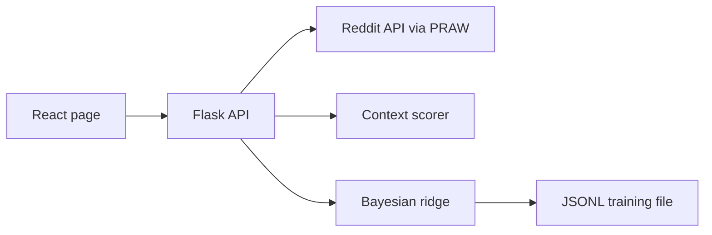
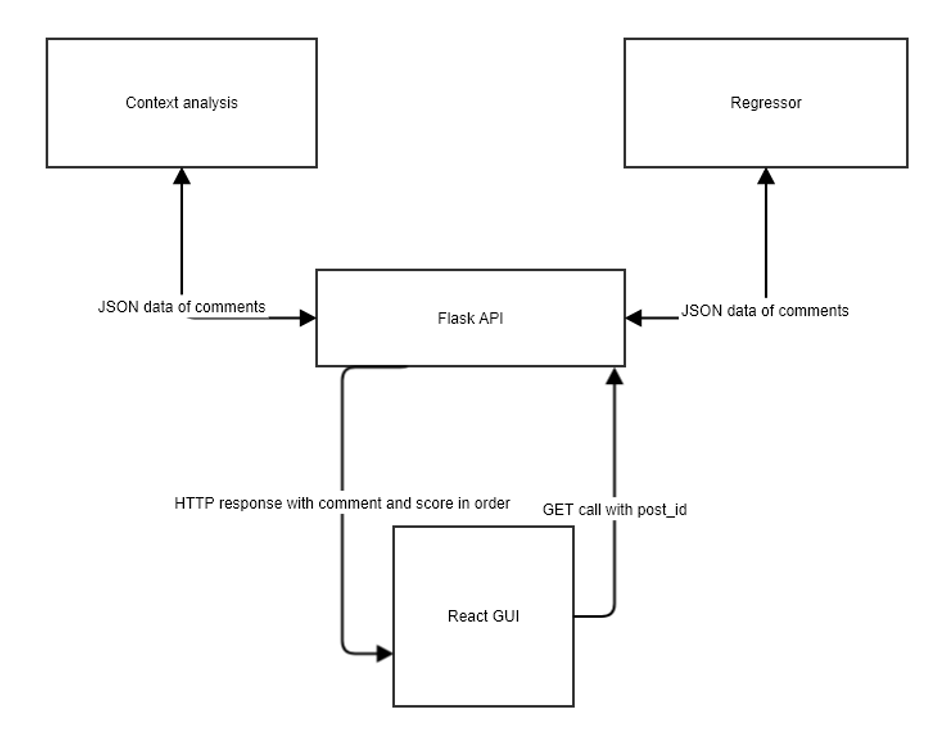
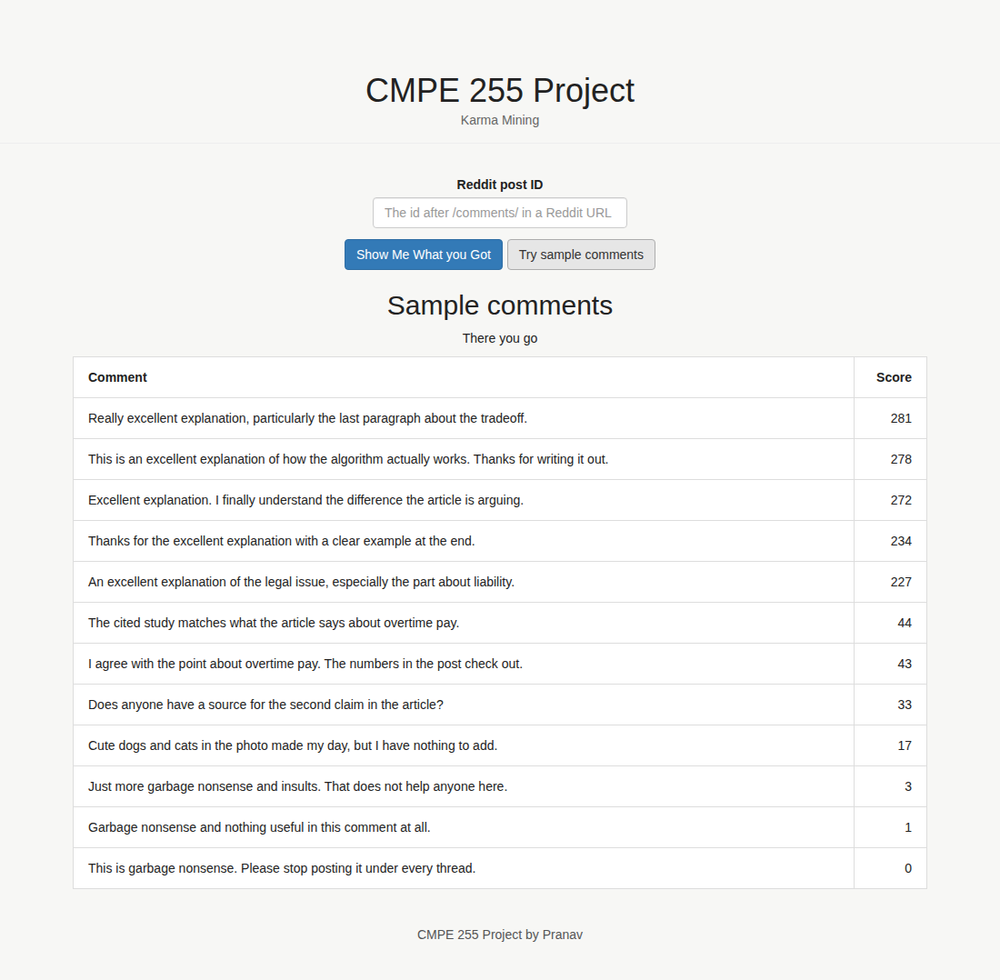
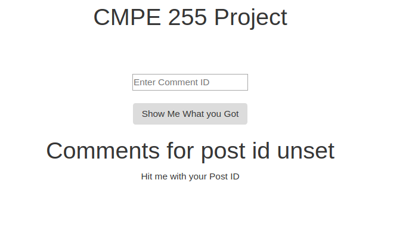
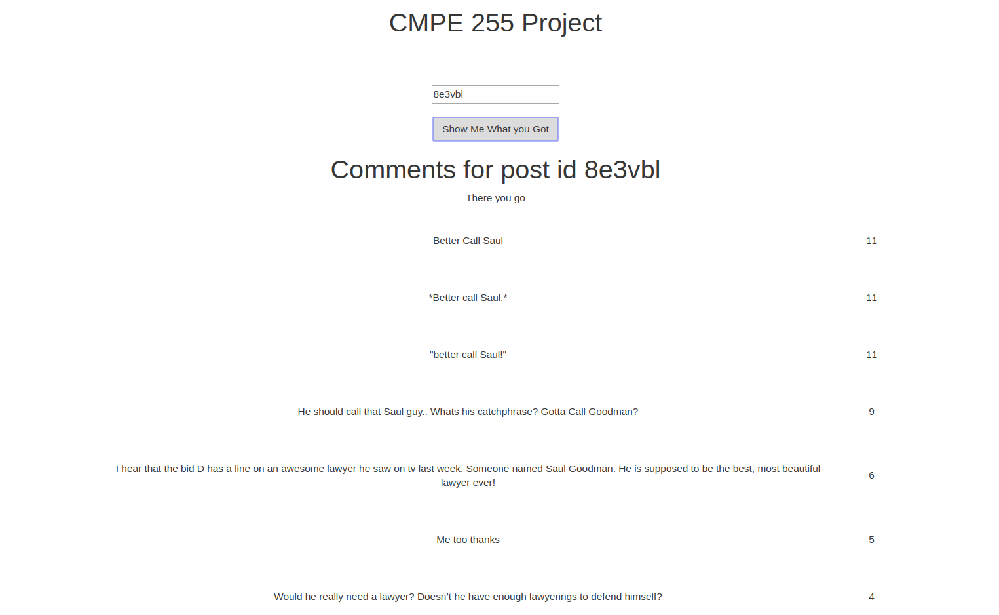
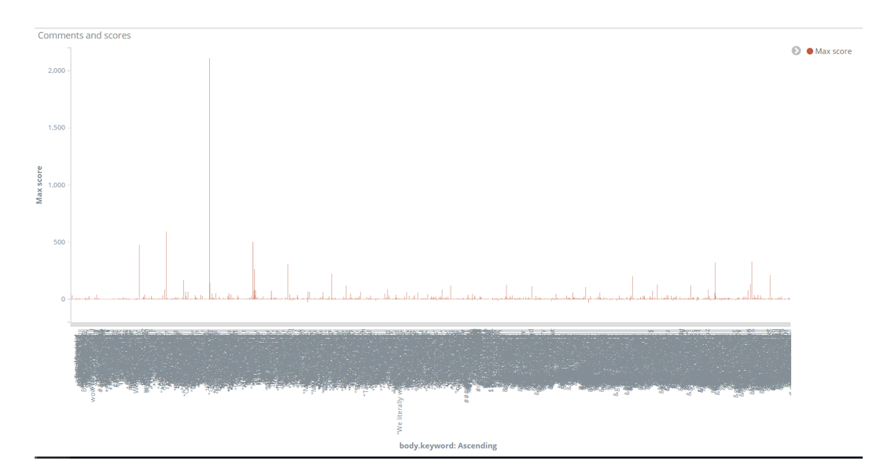
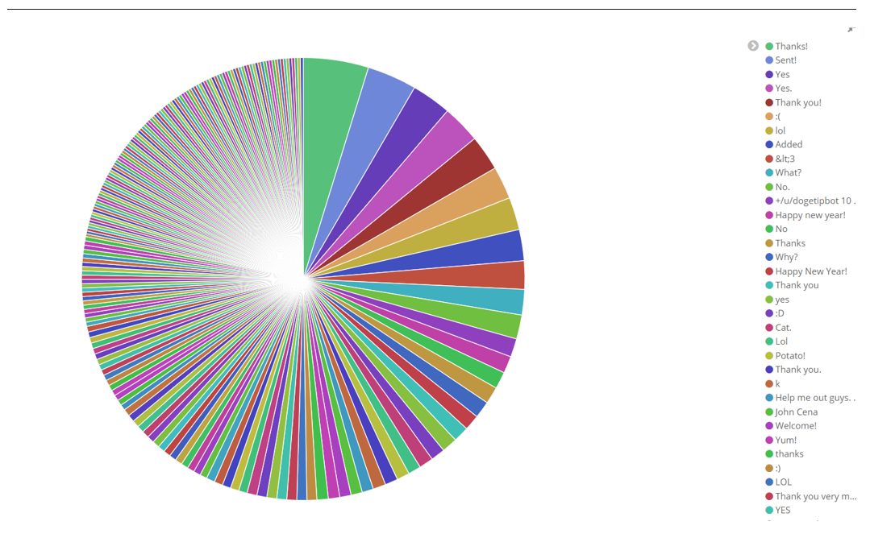

# Karma Mining

Karma Mining re-ranks the comments on a Reddit post. Instead of trusting the live upvote score, it estimates how a comment would have scored and sorts the thread by that estimate.

It was Pranav Prem's project for **CMPE 255, Data Mining, at San Jose State University, Spring 2018**. The motivation in the course report is a familiar Reddit problem: good comments posted late get buried, and the upvote total is a noisy, crowd-sourced label. The full write-up, including the literature notes and the experiment discussion, is in [docs/PROJECT_REPORT.md](docs/PROJECT_REPORT.md).

The original training set was about 1.2 million comments drawn from a public multi-year Reddit dump (the file itself was tens of gigabytes and was never committed). This repo now ships a small stand-in file so the same pipeline runs locally. Scores from that file are only there to exercise the app. They are not the 2018 model.

## How it works

The UI takes a Reddit post id. The Flask API loads the top-level comments, scores each one twice, and returns them sorted.

1. **Context score.** Comments are lowercased, stripped to alphabetic tokens, and filtered with the English stopword list. Each comment's score is the sum of its cosine similarity with every comment in the thread, including itself. Comments that share words with the rest of the thread rank higher. This was the project's lightweight stand-in for latent semantic analysis. It does not stem tokens.
2. **Regression score.** A Bayesian ridge model, trained at startup, predicts a karma score from stemmed TF-IDF counts. `SelectKBest` keeps up to 1,000 features. The report discusses trying 8,000; the code that was submitted used 1,000, and that is still the cap.
3. **Combined score.** `int(context * regression)`, truncated toward zero. Highest first. Ties break by comment text in reverse alphabetical order, which is what the original `sorted(..., reverse=True)` did.





Two debug routes return a single scorer: `GET /context_analyze/<post_id>` and `GET /regressor1/<post_id>`. The page uses `GET /combined/<post_id>`.

`GET /combined/demo` skips Reddit and scores the first 12 rows of the training file. That is the path to use when you do not have Reddit credentials.

Top-level comments only. Replies are not walked, and "load more" stubs are dropped rather than fetched. Duplicate comment text collapses to one row because the scores are stored in a dict keyed by the body.

## How to run it today

You need Python 3.12 and Node.js 22 (Node 20 or newer also works for the page).

```bash
python3 -m venv .venv
source .venv/bin/activate
pip install -r requirements.txt
python main.py
```

The API listens on port 8080 (`PORT` overrides it). In another terminal:

```bash
cd frontend
npm ci
npm start
```

Open http://localhost:3000 and choose **Try sample comments**. The first launch downloads NLTK tokenizer and stopword data.

### Live Reddit threads

Create a [script app](https://www.reddit.com/prefs/apps) and export:

```bash
export REDDIT_CLIENT_ID=...
export REDDIT_CLIENT_SECRET=...
export REDDIT_USERNAME=...
export REDDIT_PASSWORD=...
export REDDIT_USER_AGENT="karmamining comment scorer"
```

Names from the old Heroku config, `client_secret` and `reddit_password`, still work. See [.env.example](.env.example). Do not commit a filled-in `.env`.

The id to paste is the token in `https://www.reddit.com/r/<sub>/comments/<post_id>/...`, not a comment id. The page calls `http://localhost:8080` unless `frontend/.env` sets `VITE_API_URL`.

### Your own training file

`DATA_FILE` points at a JSONL file of `{"body": "...", "score": 12}` rows. The server trains when it starts, so a multi-million-row file needs the memory and time the course project needed. `python elastic.py` can index a dump for exploration. It is not part of scoring. Set `ELASTICSEARCH_URL` yourself. The old AWS hostname is gone from the script.

The `Procfile` is the original Heroku process entry. Heroku is not required to run this locally.

## Tech stack

| Piece | In 2018 | Today |
| --- | --- | --- |
| Language | Python 2.7 | Python 3.12 |
| API | Flask 0.12 | Flask 3.1 |
| Reddit | PRAW 5.4 | PRAW 8 |
| Model | `sklearn` 0.0 metapackage, NLTK 3.2, SciPy | scikit-learn 1.9, NLTK 3.10 |
| UI | React 16 on Create React App 1 | React 19 on Vite |
| Page styling | Bootstrap 3 | Bootstrap 3.4 from a CDN, plus a small local stylesheet |
| Exploration | Elasticsearch and Kibana | `elastic.py` against a cluster you supply |

Pandas is mentioned in the course report and is not imported by this code. Jupyter, EmEditor, Sublime, and VS Code were editing tools for the class, not runtime dependencies.

Lint and tests use Ruff and pytest. The page is tested with Vitest. GitHub Actions runs both on push and pull request.

## Project structure

```
main.py                      Flask routes
contextual.py                Within-thread cosine scores
regressor.py                 Bayesian ridge training and prediction
StemmedCountVectorizer.py    Snowball-stemmed counts
reddit_client.py             Credentials and the PRAW client
elastic.py                   Optional JSONL to Elasticsearch loader
data/sample_comments.jsonl   Tiny stand-in for the missing training dump
frontend/                    The one-page UI
tests/                       pytest
docs/PROJECT_REPORT.md       Original CMPE 255 report
docs/images/                 Report figures and the 2018 screenshots
.github/workflows/ci.yml
```

The 2018 page lived in `React/cmpe255` and was a Create React App shell with one real screen (`OneRingToRuleThemAll`) plus unused boilerplate. That screen is now `frontend/src/js/pages/OneRingToRuleThemAll.jsx`.

## Screenshots

The page today, after **Try sample comments**. These numbers come from the tiny bundled file, not from the 2018 model:



The 2018 page, from the course report:





Score distributions from the training experiments:





The refreshed page is the same flow: a post id, a button, then a comment and score table. **Try sample comments** is new so the UI can be opened without Reddit credentials.

## What the 2018 experiments found

Bayesian ridge beat least-angle regression and random forests on their holdout, with RMSE around 180 versus 350 or worse. Context scoring preferred comments that shared vocabulary with the thread. The regressor preferred comments that looked like historically upvoted Reddit writing, including tropes that were not about the post. The combination did better than either score alone, and it worked better on news and factual threads than on picture subs such as r/aww. Sarcasm, non-English text, and URLs were weak spots. Details and the dataset citation are in the [report](docs/PROJECT_REPORT.md).

## Develop

```bash
pip install -r requirements.txt -r requirements-dev.txt
ruff check .
ruff format --check .
pytest

cd frontend
npm ci
npm test
npm run build
```

[AGENTS.md](AGENTS.md) is the guide for working on the code: layout, commands, and the scoring behavior that should stay put.
